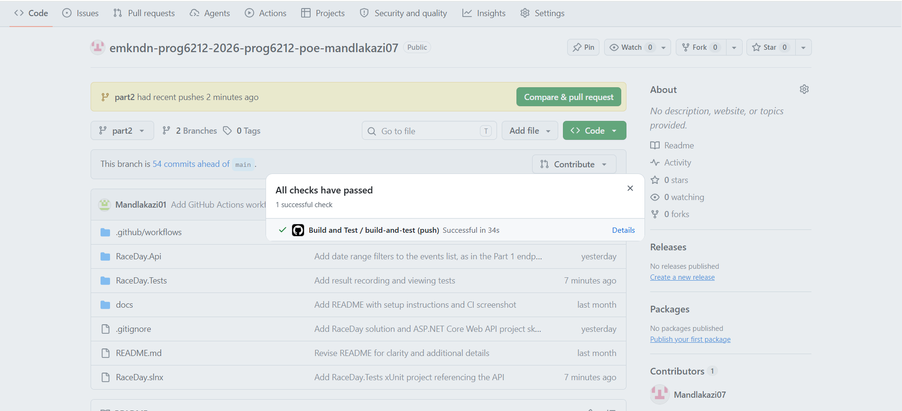

# RaceDay - Race Event Management API (Part 2)

- **Student:** Mandlakazi Sibiya
- **Student number:** ST10473547
- **Module:** PROG6212 - Programming 2B
- **Assessment:** Portfolio of Evidence (PoE), Part 2 - RESTful API
- **Institution:** The Independent Institute of Education (IIE)
- **Branch:** `part2` (Part 1 is on `main`)

## 1. Overview

RaceDay is a web-based event management system for the South African road running, walking and cycling community. Part 2 is the RESTful API that powers the whole system: it stores events, categories, enrollments and results in SQL Server, enforces who is allowed to do what, and is fully tested. It follows the endpoint plan, ERD and SQL script submitted in Part 1.

There are two roles:

- **Organizer** - creates, edits and deletes their own events and categories, views and confirms enrollments for their events, and records results after an event.
- **Participant** - browses events, enrols in an event by choosing a category, views their own enrollments, and views their own race results.

## 2. Repository structure
RaceDay.Api/ the ASP.NET Core Web API
Controllers/ endpoints: Auth, Users, Venues, Events, Categories, Enrollments, Results
Data/ AppDbContext (EF Core): tables, constraints and relationships
Dtos/ the shapes of requests and responses
Migrations/ EF Core migrations that build the database
Models/ entity classes matching the Part 1 ERD
Security/ session helpers and the [SessionAuthorize] role attribute
RaceDay.Tests/ xUnit tests (36)
docs/ Part 1 planning documents (ERD, endpoint plan, SQL script)
docs/part2/ Part 2 CI screenshots
.github/workflows/ ci.yml (Part 2 build and test) and docs-check.yml (Part 1)

## 3. Technology

- ASP.NET Core Web API, C#, .NET 10
- Entity Framework Core 10, **code-first** with migrations
- SQL Server (Express edition)
- **Session-based authentication** (server-side session, not JWT)
- BCrypt.Net-Next for password hashing
- Built-in OpenAPI plus Swagger UI for browser testing
- xUnit integration tests using an in-memory database
- GitHub Actions for continuous integration

## 4. Running the API

Prerequisites: the .NET 10 SDK, SQL Server Express, and the EF Core tool (`dotnet tool install --global dotnet-ef`).

1. Clone the repository and switch to this branch:

git clone https://github.com/Mandlakazi07/emkndn-prog6212-2026-prog6212-poe-mandlakazi07.git
cd emkndn-prog6212-2026-prog6212-poe-mandlakazi07
git checkout part2

2. Check the connection string in `RaceDay.Api/appsettings.json`. It uses `localhost\SQLEXPRESS` with Windows authentication and `TrustServerCertificate=True`. Change it if your SQL Server instance is named differently.
3. Create the database from the migrations. This creates `RaceDayApiDB` with the same six tables, keys and constraints as Part 1:

dotnet ef database update --project RaceDay.Api

4. Start the API:

dotnet run --project RaceDay.Api

5. Open Swagger UI at `http://localhost:5159/swagger` (use the port printed in the console if yours differs). Every endpoint is listed with a description, the data it expects and the responses it returns, and can be tested directly in the browser.

## 5. Authentication and roles

- **Register** with a role of `Organizer` or `Participant`. Passwords must be at least 8 characters.
- Passwords are hashed with **BCrypt** (a random salt is added automatically). The plain password is never stored, and the API never returns the hash.
- **Login** starts a server-side session that stores the user's ID and role. The browser only holds a session ID cookie (HttpOnly). Sessions expire after 30 minutes of inactivity. They live in server memory, so restarting the API logs everyone out.
- Login gives the same error for an unknown email and a wrong password, so an attacker cannot tell which one was wrong.
- The `[SessionAuthorize]` attribute protects endpoints. **401 Unauthorized** means "not logged in". **403 Forbidden** means "logged in, but the wrong role or not the owner".
- **Ownership rule:** an Organizer can only change, delete, or view enrollments and results for events they created.

## 6. Endpoints

| Method | Route | Who can call it | Main responses |
|---|---|---|---|
| POST | /api/auth/register | Public | 201, 400, 409 |
| POST | /api/auth/login | Public | 200, 401 |
| POST | /api/auth/logout | Any logged-in user | 200, 401 |
| GET | /api/users/me | Any logged-in user | 200, 401 |
| PUT | /api/users/me | Any logged-in user | 200, 400, 401, 409 |
| GET | /api/venues | Public | 200 |
| POST | /api/venues | Organizer | 201, 400, 401, 403 |
| GET | /api/events | Public (`mine=true`: Organizer) | 200 |
| GET | /api/events/{id} | Public | 200, 404 |
| POST | /api/events | Organizer | 201, 400, 401, 403 |
| PUT | /api/events/{id} | Organizer (owner) | 200, 400, 401, 403, 404 |
| DELETE | /api/events/{id} | Organizer (owner) | 204, 401, 403, 404, 409 |
| GET | /api/events/{eventId}/categories | Public | 200, 404 |
| POST | /api/events/{eventId}/categories | Organizer (owner) | 201, 400, 401, 403, 404 |
| PUT | /api/categories/{id} | Organizer (owner) | 200, 400, 401, 403, 404 |
| DELETE | /api/categories/{id} | Organizer (owner) | 204, 401, 403, 404, 409 |
| POST | /api/enrollments | Participant | 201, 400, 401, 403, 409 |
| GET | /api/enrollments/me | Participant | 200, 401, 403 |
| GET | /api/events/{eventId}/enrollments | Organizer (owner) | 200, 401, 403, 404 |
| PUT | /api/enrollments/{id}/status | Organizer (owner) | 200, 400, 401, 403, 404 |
| DELETE | /api/enrollments/{id} | Participant (owner) | 204, 401, 403, 404, 409 |
| POST | /api/results | Organizer (owner) | 201, 400, 401, 403, 404, 409 |
| GET | /api/results/me | Participant | 200, 401, 403 |
| GET | /api/events/{eventId}/results | Organizer (owner) | 200, 401, 403, 404 |

`GET /api/events` shows upcoming events and supports the filters `eventType`, `city`, `fromDate`, `toDate` and `includePast`.

Business rules the API enforces:

- A participant can only enrol once per event, only in a category that belongs to that event, and only in an event that has not already taken place.
- A new enrollment starts as `Pending`. The event's Organizer can change it to `Confirmed` or `Cancelled`.
- A result can only be recorded once the event date has arrived, only once per enrollment, and never for a cancelled enrollment.
- An event or category that already has enrollments cannot be deleted (409), and an enrollment that already has a result cannot be withdrawn (409).

## 7. Deviations from the Part 1 plan and ERD

1. **Venue endpoints added** (`GET` and `POST /api/venues`). The Part 1 schema has a Venues table, and an event needs a `VenueID`, but the plan had no way to create or list venues.
2. **Enrollment status endpoint added** (`PUT /api/enrollments/{id}/status`). Part 3 shows confirmed enrollments in green and pending ones in amber, so an Organizer needs a way to confirm an enrollment.
3. **Image upload endpoints deferred to Part 3.** The Part 1 plan included `POST /api/events/{id}/banner` and `POST /api/users/me/profile-picture`. They depend on Azure Blob Storage, which the Part 3 brief assigns to Part 3, so they are not in Part 2. The image URL columns will be added by a migration in Part 3.
4. **Extra filters on the events list** (`mine`, `includePast`) so Organizers can see their own past events and Participants only see upcoming ones.
5. **Total finishers is calculated, not stored.** The Part 1 Results table has no such column, so the API counts the results recorded for the same event. This gives "47 out of 1250" without changing the schema.
6. **Database name.** The Part 2 database is `RaceDayApiDB`, built by EF Core migrations. The tables, columns, keys and constraints are the same as the Part 1 `RaceDayDB`. The separate name keeps the Part 1 database untouched.

## 8. Unit tests

Run all tests with `dotnet test`. They need no SQL Server: each test starts the real API in memory with its own empty in-memory database, then sends real HTTP requests and checks the status codes and results. Each client has its own session cookie, so a test can act as an Organizer and a Participant at the same time.

| Area | Tests | What is checked |
|---|---|---|
| Registration, login, logout, session | 10 | valid and invalid registration, duplicate email, BCrypt hashing in the database, login success and failure, logout, unauthenticated access |
| Event management and role restrictions | 11 | Organizer can create, update and delete their own events, cannot change another Organizer's event, Participant gets 403, anonymous gets 401, filters |
| Enrollments | 10 | Participant can enrol and it is recorded correctly, duplicate enrollment, wrong category, past event, Organizer cannot enrol, confirming, withdrawing |
| Results | 5 | Organizer can record a result and the Participant sees it, Participant cannot record, too early, duplicate |

## 9. CI/CD

The workflow `.github/workflows/ci.yml` runs on every push. It restores packages, builds the whole solution, and runs all tests on a clean GitHub server.

## 10. Video

A 5 to 7 minute unlisted YouTube video demonstrates the running API, its endpoints and authentication, Swagger, the unit tests, and explains the code structure.

**Video link:** VIDEO_LINK_PENDING

## 11. AI disclosure

Claude (Anthropic) was used as an assistant while building Part 2: to suggest the project structure, draft and explain code (models, DbContext, controllers, tests and the CI workflow), draft this README, and help fix build and Git errors. Every file carries an attribution header. All code was run, tested and reviewed by the student.

## 12. References (IIE Harvard Anglia)

GitHub Docs, n.d. *Building and testing .NET*. [online] Available at: https://docs.github.com/en/actions/tutorials/build-and-test-code/net [Accessed 17 October 2026].

Microsoft Learn, 2023. *Introduction to relationships - EF Core*. [online] Available at: https://learn.microsoft.com/en-us/ef/core/modeling/relationships [Accessed 16 October 2026].

Microsoft Learn, n.d. *Get started with Swashbuckle and ASP.NET Core*. [online] Available at: https://learn.microsoft.com/aspnet/core/tutorials/getting-started-with-swashbuckle [Accessed 16 October 2026].

Microsoft Learn, n.d. *Integration tests in ASP.NET Core*. [online] Available at: https://learn.microsoft.com/aspnet/core/test/integration-tests [Accessed 17 October 2026].

Microsoft Learn, n.d. *Model validation in ASP.NET Core MVC and Razor Pages*. [online] Available at: https://learn.microsoft.com/aspnet/core/mvc/models/validation [Accessed 16 October 2026].

Microsoft Learn, n.d. *Session and state management in ASP.NET Core*. [online] Available at: https://learn.microsoft.com/aspnet/core/fundamentals/app-state [Accessed 16 October 2026].

Microsoft Learn, n.d. *TableBuilder.HasCheckConstraint(String, String) Method*. [online] Available at: https://learn.microsoft.com/en-gb/dotnet/api/microsoft.entityframeworkcore.metadata.builders.tablebuilder.hascheckconstraint?view=efcore-10.0 [Accessed 16 October 2026].
