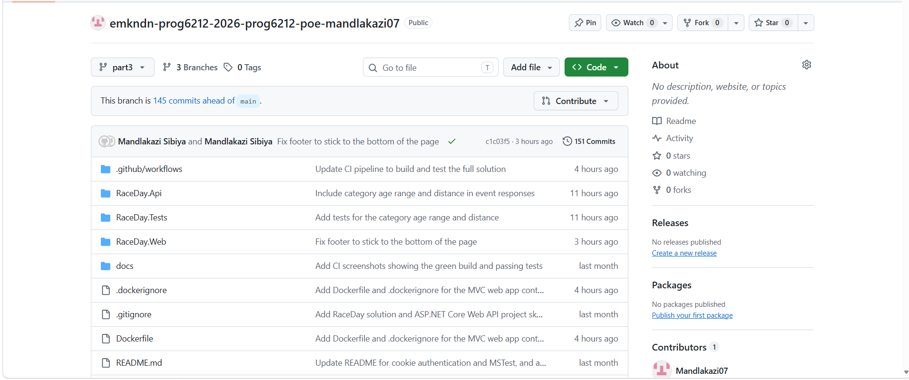

# RaceDay - Race Event Management System (Part 3: Web Application)

- **Student:** Mandlakazi Sibiya
- **Student number:** ST10473547
- **Module:** PROG6212 - Programming 2B
- **Assessment:** Portfolio of Evidence (PoE), Part 3 - MVC web application
- **Institution:** The Independent Institute of Education (IIE)
- **Branch:** `part3` (Part 1 is on `main`, Part 2 on `part2`; the Part 2 README is saved in `docs/part2/README_Part2.md`)

## 1. Overview

RaceDay is a web-based event management system for the South African road running, walking and cycling community.
Part 3 adds the website. **Organizers** create and manage events, categories and results. **Participants** browse events,
enter them, and follow their results. Pictures (event banners and profile pictures) are stored in Azure Blob Storage.
The web app runs in a Docker container.

## 2. How the parts fit together

```
Browser  ->  RaceDay.Web (ASP.NET Core MVC, in Docker)  ->  RaceDay.Api (REST API)  ->  SQL Server
                                                                    |
                                                                    +->  Azure Blob Storage (images)
```

- **RaceDay.Web has no database code and never talks to Azure.** Everything goes through the API over HTTP,
  using one class, `RaceDayApiClient`.
- Only the API reads the database, enforces the rules, and saves images to Azure.

## 3. Roles and pages

### Organizer (needs an Organizer login)
| Page | Address | What it does |
|---|---|---|
| Dashboard | /Organizer/Dashboard | Events created, upcoming events, enrolled participants per event, upcoming dates |
| My events | /Organizer/Events | List, create, edit and delete events, with an optional banner picture |
| Venues | /Organizer/Venues | Add and list venues (an event needs one) |
| Categories | /Organizer/Events/{id}/Categories | Add, edit and delete categories, with an optional age range and distance |
| Enrollments | /Organizer/Events/{id}/Enrollments | Who entered, their category and a colour-coded status; confirm or cancel |
| Results | /Organizer/Events/{id}/Results | Record each participant's finish time and position (saved results appear for the participant straight away) |

### Participant (needs a Participant login)
| Page | Address | What it does |
|---|---|---|
| Home | / | Upcoming events with filters (type, city, dates). Open to everyone |
| Event details | /Events/{id} | Full information, categories, and the Enter button. Open to everyone to read |
| My events | /Participant/MyEvents | Your enrollments with colour-coded status; withdraw |
| My results | /Participant/MyResults | Event, date, category, finish time and position such as "47th out of 1250 finishers" |
| Profile | /Participant/Profile | Update your details and upload a profile picture |

Enrollment status colours: **green** = Confirmed, **amber** = Pending, **red** = Cancelled.

## 4. Running the application

### 4.1 Prerequisites
.NET 10 SDK, SQL Server Express, the EF Core tool (`dotnet tool install --global dotnet-ef`), Docker Desktop,
and an Azure Storage account.

### 4.2 Database
```
dotnet ef database update --project RaceDay.Api
```
This creates `RaceDayApiDB` with all tables, including the image address columns and the category age range and distance.

### 4.3 Azure Blob Storage (one time)
Create a storage account and a container named `raceday-images` with blob (anonymous read) access, so browsers can show the pictures.
Then store the connection string on your own computer. It is a secret and is never committed to GitHub:
```
dotnet user-secrets init --project RaceDay.Api
dotnet user-secrets set "AzureBlobStorage:ConnectionString" "YOUR-CONNECTION-STRING" --project RaceDay.Api
```

### 4.4 Start the API
```
dotnet run --project RaceDay.Api --urls "http://0.0.0.0:5159"
```
Swagger UI is at `http://localhost:5159/swagger`.

### 4.5 Start the web app with Docker (one command)
```
docker compose up --build
```
Then open **http://localhost:8080**.

The same thing without Compose:
```
docker build -t raceday-web ./RaceDay.Web
docker run --rm -p 8080:8080 -e Api__BaseUrl=http://host.docker.internal:5159/ raceday-web
```

### 4.6 Run the web app without Docker
```
dotnet run --project RaceDay.Web
```
Then open `http://localhost:5200`. The app behaves the same in and out of Docker.

## 5. Authentication and navigation

- Register and login go through the API, which checks the password (BCrypt) and says who the user is.
- The web app then builds **its own encrypted login cookie** (`RaceDay.Web.Auth`) holding claims: user ID, name, email, role,
  and the API's login cookie value. Every page reads the user and role from that cookie.
- `ApiCookieHandler` adds the user's API cookie to each call the web app makes to the API, so the API knows who is asking.
  The built-in cookie jar of the HTTP client is switched off, because it is shared between users.
- Pages are protected with `[Authorize(Roles = "Organizer")]` and `[Authorize(Roles = "Participant")]`.
  Not logged in: sent to the login page. Wrong role: sent to an "Access denied" page. Logging in while already logged in redirects away.
- The menu changes by role (Organizer menu, Participant menu, or Log in / Join RaceDay for visitors).
  Logout removes the cookie. If the API login expires first, the user is sent back to the login page with a message.
- The API checks roles and ownership as well, so the rules are enforced in two places.

## 6. Azure Blob Storage

A picture travels: **form -> web app -> API -> Azure Blob Storage**. The API checks the file is a real JPEG, PNG or WebP of at most 2 MB
(by reading its first bytes), saves it under a random name, and stores the picture's address on the event or user.
The web app then shows the picture from that address. The web app never communicates with Azure directly.
The connection string lives only in user-secrets (on the developer's computer) or an environment variable. Microsoft's quickstart
recommends passwordless sign-in for production; a connection string was used here for simplicity.

## 7. Docker

`RaceDay.Web/Dockerfile` is a two-stage build: the first stage uses the .NET SDK to build and publish the app, and the second uses only
the small ASP.NET runtime, so the final image is small. It runs as a non-root user and listens on port 8080.
`docker-compose.yml` lets one command build and start it.

## 8. Design decisions and deviations

1. **Only the web app is containerised.** The API uses SQL Server Express with Windows login on the host computer, which a Linux
   container cannot use, so the container calls the API on the host (`host.docker.internal`). The API must be started first.
2. **Web login uses cookie authentication with claims**, matching the API and the module's Auth API example,
   and forwards the API's login cookie on each call.
3. **Image upload endpoints** (event banner, profile picture) were in the Part 1 plan and are built in Part 3 with Azure Blob Storage.
4. **Categories gained an optional minimum age, maximum age and distance** (Part 2 feedback). The API refuses a minimum age above the maximum.
5. **Venue pages were added** because every event needs a venue.
6. **A new enrollment is Pending** until the Organizer confirms it, which gives the green and amber statuses.
7. **"Publishing" a result means saving it:** a saved result is immediately visible to the participant.
8. **Numbers always use a dot** (the web app uses the invariant culture), because a South African computer writes decimals with a comma
   but browsers send a dot.

## 9. Testing

The API behind the pages is covered by automated tests (`dotnet test`): registration, login and roles, event management and role
restrictions, enrollments, results, image uploads (using a fake image store, so no Azure is needed), and category age range and distance.
The web pages were tested by hand (registering, logging in as each role, creating events with banners, entering events, confirming,
recording results, uploading pictures, and trying protected pages while logged out or with the wrong role).

## 10. CI/CD

The workflow `.github/workflows/ci.yml` runs on every push. It restores packages, builds the whole solution including the MVC web project,
runs all the tests, and builds the Docker image.




## 11. Video

An unlisted YouTube video demonstrates the full application, the MVC pages, Azure Blob Storage, and the Docker setup, with an explanation of the code.

**Video link:** VIDEO_LINK_PENDING

## 12. AI disclosure

Claude (Anthropic) was used throughout Part 3 to plan the work, draft and explain code (the API image endpoints, the MVC pages, the Dockerfile,
the CI workflow and this README), and to help fix build errors. DeepSeek was also used to help troubleshoot terminal errors.
Every file carries an attribution header. All code was run, tested and reviewed by the student.

## 13. References (IIE Harvard Anglia)

Adnan, Y., n.d. *Application Programming Interface* [lecture slides]. PROG6212, The Independent Institute of Education (IIE).

Adnan, Y., n.d. *Authentication_API_With_UnitTesting*. [online] GitHub. Available at: https://github.com/YusraAdnan/Authentication_API_With_UnitTesting [Accessed 19 November 2026].

Adnan, Y., n.d. *Unit testing with the Auth API* [lecture notes]. PROG6212, The Independent Institute of Education (IIE).

Bootstrap, n.d. *Bootstrap 5.3 documentation*. [online] Available at: https://getbootstrap.com/docs/5.3/getting-started/introduction/ [Accessed 19 November 2026].

GitHub Docs, n.d. *Building and testing .NET*. [online] Available at: https://docs.github.com/en/actions/tutorials/build-and-test-code/net [Accessed 19 November 2026].

Microsoft Learn, 2023. *Introduction to relationships - EF Core*. [online] Available at: https://learn.microsoft.com/en-us/ef/core/modeling/relationships [Accessed 19 November 2026].

Microsoft Learn, n.d. *Get started with Swashbuckle and ASP.NET Core*. [online] Available at: https://learn.microsoft.com/aspnet/core/tutorials/getting-started-with-swashbuckle [Accessed 19 November 2026].

Microsoft Learn, n.d. *Integration tests in ASP.NET Core*. [online] Available at: https://learn.microsoft.com/aspnet/core/test/integration-tests [Accessed 19 November 2026].

Microsoft Learn, n.d. *Make HTTP requests using IHttpClientFactory in ASP.NET Core*. [online] Available at: https://learn.microsoft.com/aspnet/core/fundamentals/http-requests [Accessed 19 November 2026].

Microsoft Learn, n.d. *Model validation in ASP.NET Core MVC and Razor Pages*. [online] Available at: https://learn.microsoft.com/aspnet/core/mvc/models/validation [Accessed 19 November 2026].

Microsoft Learn, n.d. *Quickstart: Azure Blob Storage client library for .NET*. [online] Available at: https://learn.microsoft.com/azure/storage/blobs/storage-quickstart-blobs-dotnet [Accessed 19 November 2026].

Microsoft Learn, n.d. *Tutorial: Containerize a .NET app*. [online] Available at: https://learn.microsoft.com/dotnet/core/docker/build-container [Accessed 19 November 2026].

Microsoft Learn, n.d. *Upload files in ASP.NET Core*. [online] Available at: https://learn.microsoft.com/aspnet/core/mvc/models/file-uploads [Accessed 19 November 2026].

Microsoft Learn, n.d. *Use cookie authentication without ASP.NET Core Identity*. [online] Available at: https://learn.microsoft.com/aspnet/core/security/authentication/cookie [Accessed 19 November 2026].

