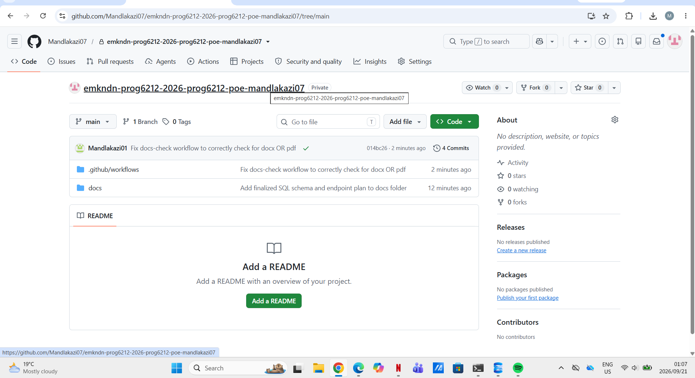

# RaceDay — Race Event Management System

**Student:** Mandlakazi Sibiya
**Student Number:** ST10473547
**Module:** PROG6212 — Programming 2B
**Assessment:** Portfolio of Evidence (PoE) — Part 1
**Institution:** The Independent Institute of Education (IIE)

## Overview

RaceDay is a full-stack, web-based event management system built for the South African road running, walking, and cycling community. It allows Organizers to create and manage events, categories, and results, and allows Participants to browse events, enroll in a category, and track their personal race history.

This repository contains **Part 1** of the PoE: system planning, consisting of an Entity Relationship Diagram, an API endpoint plan, and a SQL Server database script — no application code is written in this part.

## Roles

- **Organizer** — creates, edits, and deletes events; defines age/distance categories per event; views all participant enrollments for their events; captures finish times and positions after an event.
- **Participant** — browses upcoming events; enrolls in an event by selecting a category; views their own enrollment history; tracks their personal race results.

## Repository Structure

```
/docs
  RaceDay_ERD.png              - Entity Relationship Diagram (Section A)
  RaceDay_Endpoint_Plan.pdf    - Full API endpoint plan, covering Part 2 (API) and Part 3 (MVC) (Section B)
  RaceDay_Schema.sql           - SQL Server schema + seed data + verification queries (Section C)
/.github/workflows
  docs-check.yml                - CI workflow verifying /docs contains the required files
README.md                       - This file
```

## Setup Instructions

1. Clone this repository:
   ```
   git clone https://github.com/Mandlakazi07/emkndn-prog6212-2026-prog6212-poe-mandlakazi07.git
   ```
2. Install SQL Server (Express edition is sufficient) and SQL Server Management Studio (SSMS).
3. Open `docs/RaceDay_Schema.sql` in SSMS via **File → Open → File** (do not copy-paste the script — this can corrupt quotation marks).
4. Connect to your local instance (e.g. `.\SQLEXPRESS`) and execute the script (F5).
5. The script creates the `RaceDayDB` database, all six tables with constraints, seed data, and a set of readable verification queries you can run to confirm the data.

## Entity Relationship Diagram

See `docs/RaceDay_ERD.png`. Six entities: Users, Venues, Events, Categories, Enrollments, Results. Cardinality shown using `1..1` / `1..*` notation on every relationship, with direction arrows and verb labels.

## API Endpoint Plan

See `docs/RaceDay_Endpoint_Plan.pdf`. Covers Authentication, User Profile, Events, Categories, Enrollments, Results (Part 2 API), and the MVC page routes that will consume them (Part 3).

## CI/CD

A GitHub Actions workflow (`.github/workflows/docs-check.yml`) runs on every push and verifies that `/docs` contains the ERD image, the SQL script, and the endpoint plan document.

<!-- TODO: paste the green Actions run screenshot here, e.g.:

-->

## Video

A 5–7 minute unlisted YouTube video walks through the ERD (explaining each relationship's entities, direction, and cardinality reasoning), one endpoint per resource group tied to its functional requirement, and a live run of the SQL script in SSMS with seeded data visible.

<!-- TODO: paste the unlisted YouTube link here -->
**Video link:** _pending_

## References (IIE Harvard Anglia)

Sibiya, M., 2026. *RaceDay: Portfolio of Evidence, Part 1 — System Planning*. Durban: The Independent Institute of Education (IIE).
